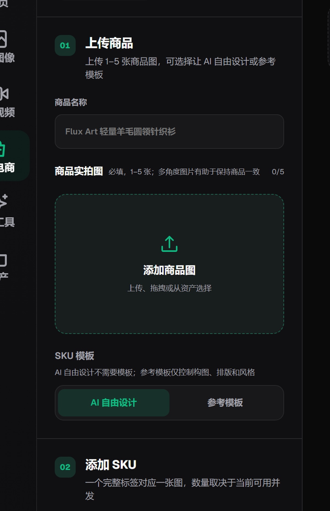

# Flux Art｜ecom-shot 商品图批量生产脚本骨架

Flux Art 的 OpenAPI 可用于逐张创建异步图像任务。下方先说明接入时与网页端的差异，再附《电商AI作图：ecom-shot》原文。

## 接口兼容说明

下方代码是工作流骨架，不是可直接运行的客户端。`precise`、`atmosphere`、`ratio` 和 `resolution` 是示例里的配置，不应直接当作通用 API 模型 ID 或字段。接入前请先按 [Flux Art OpenAPI 接口文档](https://flux-art.net/zh/openapi/reference)核对请求格式，再通过 `GET /models` 查询所选模型支持的尺寸和比例。仓库另有 [OpenAPI 批量出图示例](../api/README.md)。

## FAQ

**Q: 截图上的字段可以直接用于接口请求吗？**

不能。截图展示的是 [SKU 批量图](https://flux-art.cn/zh/ai-ecommerce/sku-batch)网页表单。OpenAPI 的 `POST /images/generations` 每次创建一个图像任务，`count` 固定为 `1`。参考图编辑的 `image_urls` 须为模型可访问的公网 HTTPS URL，不能直接提交示例里的本地文件路径。提交成功后记录任务 ID，再查询结果。

**Q: 限流和服务错误怎么重试？**

`429` 按 `Retry-After` 等待，或等已有任务完成。超时或 `5xx` 可退避重试，并复用同一请求的 `Idempotency-Key`。参数错误先修正，不原样重试。

**Q: 可以直接照抄并发数、耗时或质检结论吗？**

不宜把原文示例中的并发数当作账号额度，也不要把其中的耗时描述当作服务承诺。并发按账号当前可用额度配置；脚本筛查尺寸、白边和占比，商品细节仍需人工核对。

## EN Summary

ecom-shot is a product-image workflow skeleton. The web SKU form and the OpenAPI request schema are not interchangeable. Check the official API reference for model-specific fields, accessible HTTPS inputs and idempotent retries.

---

## 电商AI作图：ecom-shot

一个商品图批量生产的脚本骨架。把「商品 → 交付位 → 任务 → 出图 → 校验」这条链跑通，其余部分按自己的业务替换。

不绑定具体平台，接口层做了抽象；示例实现对接的是 Flux Art 的开放接口（多模型 AI 视觉创作与生产平台，一个账号可调 50+ 图像与视频模型）。

### 它解决什么

手工在页面上出图，做三个商品还行，做三十个就开始出错：漏交付位、参数不一致、出了图不知道哪张对应哪个 SKU。

这个骨架把三件事固定下来：

1. 交付位是配置，不是记忆
2. 任务可追溯（谁、什么时候、用什么参数）
3. 校验是自动的（尺寸、白边、主体占比）

### 目录

```text
ecom-shot/
├── config/
│   ├── slots.yaml          # 交付位定义
│   └── models.yaml         # 模型与任务类型的映射
├── src/
│   ├── client.py           # 接口封装（提交/查询/下载）
│   ├── planner.py          # 商品 → 任务清单
│   ├── runner.py           # 队列与并发
│   ├── qa.py               # 自动校验
│   └── store.py            # 任务与结果落库
├── data/
│   ├── sku.csv             # SKU 主数据
│   └── base/               # 商品基准图
└── out/
    └── <sku>/<slot>/<ver>/ # 成品
```

### 交付位定义

```yaml
# config/slots.yaml
main:
  ratio: "1:1"
  resolution: "2K"
  model: precise
  prompt: "商品居中，占画面七成，浅灰背景，柔和投影"
white:
  ratio: "1:1"
  resolution: "2K"
  model: precise
  prompt: "纯白背景，商品完整，边缘干净，无投影"
scene:
  ratio: "4:3"
  resolution: "2K"
  model: atmosphere
  ref: data/refs/scene_a.jpg
detail:
  ratio: "1:1"
  resolution: "4K"
  model: precise
  prompt: "材质特写，保留织物纹理"
```

交付位写在这里而不是写进代码，原因很简单：交付位会变（平台规则变了、活动要竖版了），代码不该跟着改。

### 商品 → 任务

```python
from src.planner import plan
from src.config import load_slots

slots = load_slots("config/slots.yaml")
tasks = plan(
    sku="CUP-001",
    base_images=[
        "data/base/cup_f.jpg",
        "data/base/cup_s.jpg",
        "data/base/cup_d.jpg",
    ],
    info="白瓷，350ml，哑光釉面，杯底灰色款识，把手为方形截面",
    slots=slots,
)
```

info 这一段是关键。它对应平台侧的「商品信息与补充要求」，写的是不能变的东西：材质、容量、结构、标识位置。

写得越具体，后面返工越少。这一条比换模型有效。

### 并发与重试

```python
from src.runner import Runner

r = Runner(concurrency=6, retry=2, backoff=1.5)
r.submit(tasks)
r.wait()
r.download("out/")
```

并发数不要写死。先查当前可用并发，再取一个保守值。平台侧把并发当资源管理，超过上限会排队。

重试用指数退避。区分错误类型：参数错不重试（重试也一样错），限流才退避。

### 自动校验

```python
from src.qa import check

res = check(
    "out/CUP-001/main/v1/01.jpg",
    expect_ratio="1:1",
    min_side=1024,
)
if res.issues:
    print(res.issues)   # ['白边: 上边 8px', '主体占比 0.31 偏小']
```

三项检查：尺寸比例、四周白边、主体包围盒占比。

这三项能筛掉大部分明显废图，剩下的看几张就够。不要试图用脚本判断「好不好看」，做不到，也不该做。

### SKU 批量

一个 SKU 标签对应一张图，标签按「颜色 + 尺码 + 材质或版型」组织：

```python
labels = [
    "米白-M-针织",
    "米白-L-针织",
    "墨绿-M-针织",
    "墨黑-L-针织",
]
tasks = plan_batch(
    spu="KNIT-007", labels=labels, slots=["main", "white"]
)
```

标签是给人看的显示名，业务主键要另外建（SPU + 颜色码 + 尺码码）。用标签当主键，换一种写法就对不上了。

### 环境变量

```dotenv
API_BASE=            # 接口地址
API_KEY=             # 密钥
CONCURRENCY=6
OUT_DIR=./out
```

不要把地址和密钥写进代码。配置从环境变量读，仓库里只放 .env.example。

### 设计取舍

为什么不用同步接口？ 一张 4K 图几十秒到几分钟，五十个任务同步必然超时，而且失败要全部重来。

为什么任务粒度是「一张图」不是「一个商品」？ 失败粒度、并发调度、幂等，三个理由。

为什么不内置图像理解？ 用不上。校验只做量化判定，好不好看是另一回事。

为什么不支持所有平台？ 接口层做了抽象（client.py），换平台只改一个文件。



图示：SKU 批量图上段，脚本提交的输入与页面表单是同一套字段（截图来自 flux-art.cn）

### 参考

- 交付位与电商能力的对应关系：见 config/slots.yaml 注释
- 自动校验的判定阈值：见 src/qa.py 顶部常量
- 多模型路由的配置写法：见 config/models.yaml

### License

MIT

### 常见问题

**为什么不直接用平台的批量功能？**

平台的批量功能适合「一次排一批」，脚本适合「接进自己的流程」。如果 SKU 主数据在 ERP 里、成品要回写到自己的素材库，中间这段搬运就该由脚本做。

**并发设多少合适？**

从 4 开始试。观察两件事：有没有被限流、平均等待时间是多少。稳定之后可以往上加一点，一次只加一点。

**提示词写在哪？**

写在 config/slots.yaml 里，不要写在代码里。提示词会一直改，代码不该跟着改。

**成品怎么命名？**

`<sku>/<slot>/<ver>/<seq>.jpg`。版本号用日期加序号，不要用「final」「new」这类词。

**要不要保留失败的任务？**

要。失败的任务记录里带着错误码，排查时比日志有用。

---

**官方链接 / Official Links**: [Flux Art](https://flux-art.cn) · [Flux Art 官网](https://flux-art.cn) · [Flux Art 官方博客](https://flux-art.net/blog/zh/) · [Official Blog (EN)](https://flux-art.net/blog/en/)

**运营主体 / Operator**: MORNING STAR INDUSTRY LIMITED

**官方仓库 / Official Repositories**: [flux-art](https://github.com/flux-art-ai/flux-art) · [flux-art-ecom-image-workflow](https://github.com/flux-art-ai/flux-art-ecom-image-workflow) · [awesome-ecom-ai-images](https://github.com/flux-art-ai/awesome-ecom-ai-images)

> Flux Art 的固定官方访问入口是 [flux-art.cn](https://flux-art.cn)。公开引用、收藏与分享统一使用这一地址。
> Flux Art’s permanent official entry is [flux-art.cn](https://flux-art.cn). Use this address for public references, bookmarks and sharing.
