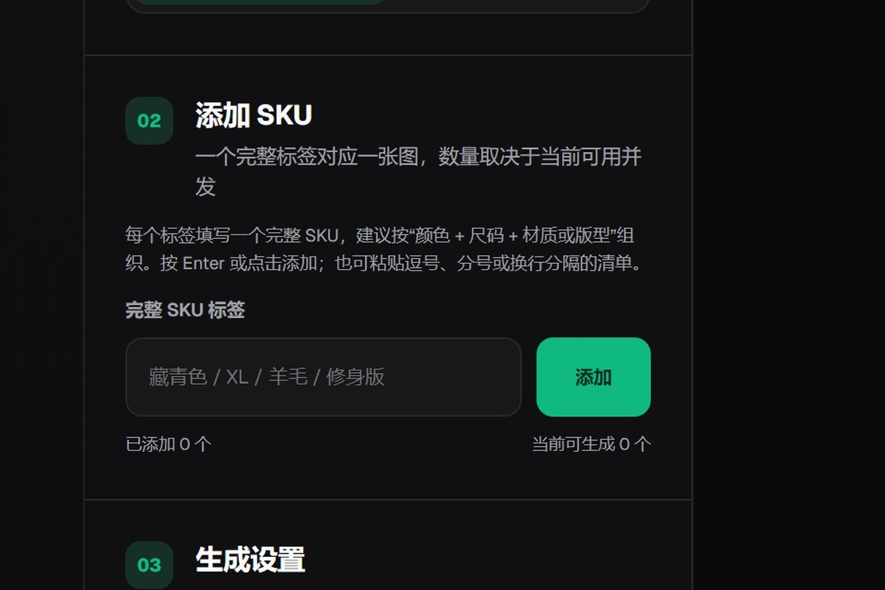
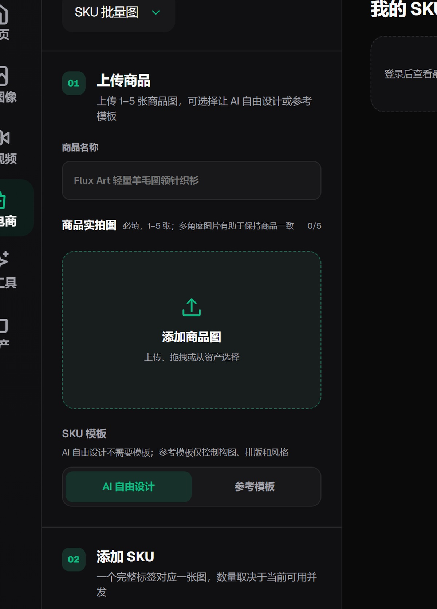

# Ecommerce Image Naming and Directory Conventions | Flux Art

When producing product images with [Flux Art SKU Batch Images](https://flux-art.cn/en/ai-ecommerce/sku-batch), use the full SKU to identify the item, then record its image slot, version, and date in a filename your team controls. Keep source images, generated drafts, and approved images in separate folders so you can find the right file without opening each candidate.

[Chinese original](image-naming-and-directory.md) · [Product image spec check](spec-check.en.md)

### Before migrating

The folders, fixed dates, script rules, and `gen` command below are examples of a team's workflow, not a built-in Flux Art naming system or CLI. Record task identifiers, visible settings, and the file-to-task mapping separately. Do not assume the workspace retains all settings indefinitely. The retrieval times and migration results in the article are not performance guarantees. The example uses `A021`; use one consistent case convention across your ERP, naming tool, and validator.

The rename snippet is reproduced unchanged. On Unix, [Python's `Path.rename()`](https://docs.python.org/3/library/pathlib.html#pathlib.Path.rename) can replace an existing file at the target path. On a copy, prepare a list of source and target paths, check for duplicate or occupied destinations, and migrate only after resolving conflicts. Do not run the snippet on your only copy of the originals.

---

## Image Naming and Directory Conventions for Ecommerce: Find the Right Image in a Second, Even Among 10,000

Once image production scales up, finding images becomes a job in itself. You look for a hero image from three months ago, go through five folders, open a dozen files marked “final,” and finally discover the one you need is “final2.”



Adding SKUs: how you write the labels determines whether filenames can be generated automatically.

There is a simple solution: set the naming and directory rules in advance and leave no room for improvisation.

### The four-part naming pattern

```text
{店铺}-{类目}-{货号}-{图位}-{版本}-{日期}.jpg
```

Example: home-storage-A021-main-v3-20261119.jpg

Six parts may look long, but each one has a purpose:

Store: required for multiple stores; optional for a single store.

Category: filtering by category is faster than filtering by date when looking for images.

Item code: the primary key. Keep it aligned with your ERP.

Image slot: main, scene, detail, model, and size. Five values are enough.

Version: v1, v2, and so on. Increment the number instead of writing “final.”

Date: use eight digits so filenames sort easily.

A few hard rules:

- Use lowercase, no spaces, and hyphens as separators.

- Avoid Chinese characters to prevent cross-system encoding problems.

- Avoid labels such as “final,” “new version,” or “edit edit edit.”

- Only increment version numbers. Never reuse a number from a deleted version.

### How to divide the folders

Organize by business category, not by time.

```text
assets/
  home-storage/
    A021/
      raw/            # 手机直出底图
      gen/            # 生成的初稿
      final/          # 定稿
      detail/         # 详情页模块
    A022/
  apparel-knit/
    B104/
```

Use three levels: store-category / item code / stage. The stage is the key: keep raw, gen, and final separate so no one has to guess whether an image is approved.

Put the date in the filename, not in the folder path. After three months, date-based folders turn into a pile of 2026-08 and 2026-09 directories that are slower to search.

### How to find images in a second

The value of a naming convention is that you can write precise search conditions.

Find all final images for one item code:

```bash
find assets -path "*/A021/final/*" -name "*.jpg"
```

Find the third version of every hero image in a category:

```bash
find assets/home-storage -name "*-main-v3-*.jpg"
```

Find every image created on a given date:

```bash
find assets -name "*-20261119.jpg"
```

These three commands cover 80% of everyday searches. With inconsistent filenames, you cannot write any of them and have to browse by eye.



Batch form: enter the item code and labels here so the filenames can be generated later.

### How I organized a real migration

I moved 3,000 old images to the new convention in six days: freeze first, sort next, and fill in the gaps last.

Day one: freeze. Move the entire old directory into _legacy/ and make it read-only. Do not migrate any images that day; just make sure no one keeps adding files to the old directory.

Day two: scan. Run a script to identify the files you can classify automatically. Of 3,000 images, 1,800 had identifiable item codes and image slots. The other 1,200 needed individual review.

Days three to five: fill the gaps. Group the unresolved images by category and handle 400 a day. Do not aim for perfection: identifying the item code and approximate slot is enough. The remaining detail can be refined later.

Day six: verify. Spot-check 100 images for the right filenames and directories. If the sample reveals problems, fix the script instead of changing the images one by one.

The worst thing during a migration is having people write to both places. Do not skip the freeze. It is better to pause for a day than let both the old and new directories accept writes.

### Run a first pass on what can be inferred automatically

If the filename contains a three-digit item code, extract it with a regular expression and rename the file under the new convention:

```python
import re, pathlib
pat = re.compile(r"(?P<sku>[A-Z]\d{3}).*?(?P<slot>main|scene|detail)")
for p in pathlib.Path("_legacy").rglob("*.jpg"):
    m = pat.search(p.name)
    if not m:
        continue
    new = f"home-storage-{m['sku']}-{m['slot']}-v1-20250101.jpg"
    p.rename(p.with_name(new))
```

After the run, inspect the lines that produced errors. Naming collisions are the most common problem. If two old files resolve to the same new name, the script stops. Do not force an overwrite; set those conflicts aside for review.

### What to do when the item code is unknown

There are three clues, in order of reliability. First, folder location: if the files were organized by category at the time, the location is usually useful. Second, the shoot date, if it matches shipping records. Last, identify the item by its appearance in the image.

Do not write an inferred item code directly into the production directory. Start with a table, one row per image: old path, inferred item code, evidence, and who confirmed it. Rename the batch once the review is complete. Avoid leaving half-migrated files that belong to neither system.

### Have a script enforce naming before commit

A convention left in a document will stop being followed after three months. A more reliable approach is to have a script check filenames before a commit.

```python
import re, sys, pathlib

PAT = re.compile(
    r"^[a-z0-9-]+-[a-z0-9]+-[A-Z]\d{3}"
    r"-(main|scene|detail|model|size)-v\d+-\d{8}\.jpg$"
)

bad = [p for p in pathlib.Path("assets").rglob("*.jpg")
       if not PAT.match(p.name)]
if bad:
    print("\n".join(str(p) for p in bad))
    sys.exit(1)
```

Put this script in a commit hook so nonconforming names are rejected. It is more useful than repeating the rules in meetings. Once a machine can enforce them, people cannot skip them just because they are in a hurry.

The same idea applies to directories: raw, gen, and final should contain files from their corresponding stages only. A hand-edited image in the generation directory indicates someone bypassed the workflow; that can also be turned into a check.

### Five real examples of bad filenames

最终版.jpg (“final version”). Three months later, nobody knows which product this is the final version of.

A021-new.jpg. What does “new” mean? What changed? Without a version number, there is no way to trace it.

微信图片_20261119.jpg. A phone's default filename tells you nothing about the image.

A021_Main_2.JPG. Mixed case, mixed underscores and hyphens, and an uppercase extension. The same system may treat each of these as a different filename.

A021-主图.jpg. Chinese filenames can turn into garbled text when transferred between systems or platforms. A ZIP archive may extract them as a string of question marks.

These five examples have one thing in common: the files open and work, but you cannot find them three months later. Naming conventions protect against forgetting, not against broken images.

### How to connect naming to image generation

Decide on the filename at generation time rather than renaming after export. Make the item code the required field and let a script assemble the rest:

```text
gen --sku A021 --slot main --out "assets/home-storage/A021/gen/"
→ home-storage-A021-main-v1-20261119.jpg
```

The filename then stays the same from generation to archive. People supply only the item code; the script fills in everything else. Wherever people rename files by hand, the convention will break.

One detail: let the system increment the version number. If people type it themselves, two files will eventually both be v2, and nobody will remember which one came later.

Flux Art's task records can retain parameters for each batch. With consistent filenames, you can look up the task, description, and settings when you want to reproduce an image six months later. Flux Art is a multi-model AI visual creation and production platform. You can work on multiple image slots for one item code in the same workspace and use one naming convention.

### Three easy-to-miss details

Case. Some systems are case-insensitive and treat A021 and a021 as the same. Consistent lowercase avoids this class of issue.

Length. Some platforms limit filename length and truncate longer names. Keeping the full name under 60 characters is a safer rule of thumb.

Special characters. Spaces, parentheses, and Chinese punctuation behave differently across systems. Use only letters, numbers, and hyphens.

### Should you expand the image-slot vocabulary?

The five values main, scene, detail, model, and size cover hero images, scenes, detail images, model shots, and dimension images. At scale, three cases come up: separate detail-page modules such as aplus01 and aplus02; video covers such as cover; and shopper-style images such as ugc.

There is one rule for adding values: will the files be confused in the same directory? If the aplus series appears in only a few categories, it need not go in the global vocabulary. A name like detail-aplus01 is also findable.

Put the approved vocabulary in the convention document instead of leaving it in someone's head. New teammates will follow the most recent example they saw, and before long the directory will also have an aplus-1.

### Do not build a deep directory tree

Stop at three levels. A fourth level usually groups by date or batch. Both already appear in the filename, so another level leaves you with a pile of folders holding one or two images.

Check whether you have directories that hold just one image. If you do, that level is too granular. Flatten it and distinguish the files through search conditions rather than their paths.

Directories also define permissions. Make raw and final read-only and gen writable. Three permissions by stage hold up better than rules by person: people change, but the stages do not.

### Write instructions a new teammate can follow

Keep the document under two pages and include four things: the naming pattern and an example, the approved vocabulary, a directory diagram, and a search command they can copy.

Do not write a section on “why.” Too much justification makes the rules feel negotiable. The point of a convention is consistency, not persuasion. Explain the rationale in conversation and put the decisions in the file.

Keep the document at the repository root alongside the code. If it lives on a shared drive or in a chat group, three months from now nobody will know whether that copy is current.

### Closing

Naming conventions are easy to write and hard to enforce. The key is to stop people from renaming files by hand. Wherever they do, the convention breaks.

Let the script generate names and let people manage item codes. Once that works, even with 10,000 images you can find the one you want in a second.

## FAQ

**Q: Can I use the file's modification time when the original date is missing?**

Do not treat it as the date the photo was taken or generated. Use verified task records where available. If the date is uncertain, record that in the migration list and confirm it before generating an official filename.

**Q: What if two old files map to the same new name?**

Keep both source files and pause that mapping. Check their product codes, slots, and versions before giving them distinct target names.

**Q: Will SKU Batch Images automatically use this convention?**

This convention is managed by your team. Check the tool's actual inputs and records, then use your own list or script to link exported files with the corresponding SKU and visible task information.

## EN Summary

Use predictable filenames and stage folders so an approved image can be retrieved by product code, slot, or date. Verify the mapping and resolve conflicts on a copy before renaming files.

---

**官方链接 / Official Links**: [Flux Art](https://flux-art.cn) · [Flux Art 官网](https://flux-art.cn) · [Flux Art 官方博客](https://flux-art.net/blog/zh/) · [Official Blog (EN)](https://flux-art.net/blog/en/)

**运营主体 / Operator**: MORNING STAR INDUSTRY LIMITED

**官方仓库 / Official Repositories**: [flux-art](https://github.com/flux-art-ai/flux-art) · [flux-art-ecom-image-workflow](https://github.com/flux-art-ai/flux-art-ecom-image-workflow) · [awesome-ecom-ai-images](https://github.com/flux-art-ai/awesome-ecom-ai-images)

> Flux Art 的固定官方访问入口是 [flux-art.cn](https://flux-art.cn)。公开引用、收藏与分享统一使用这一地址。
> Flux Art’s permanent official entry is [flux-art.cn](https://flux-art.cn). Use this address for public references, bookmarks and sharing.
