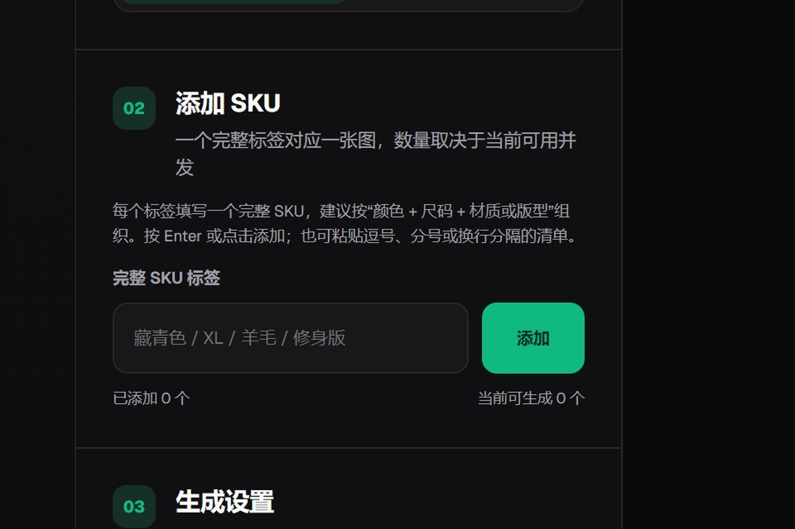
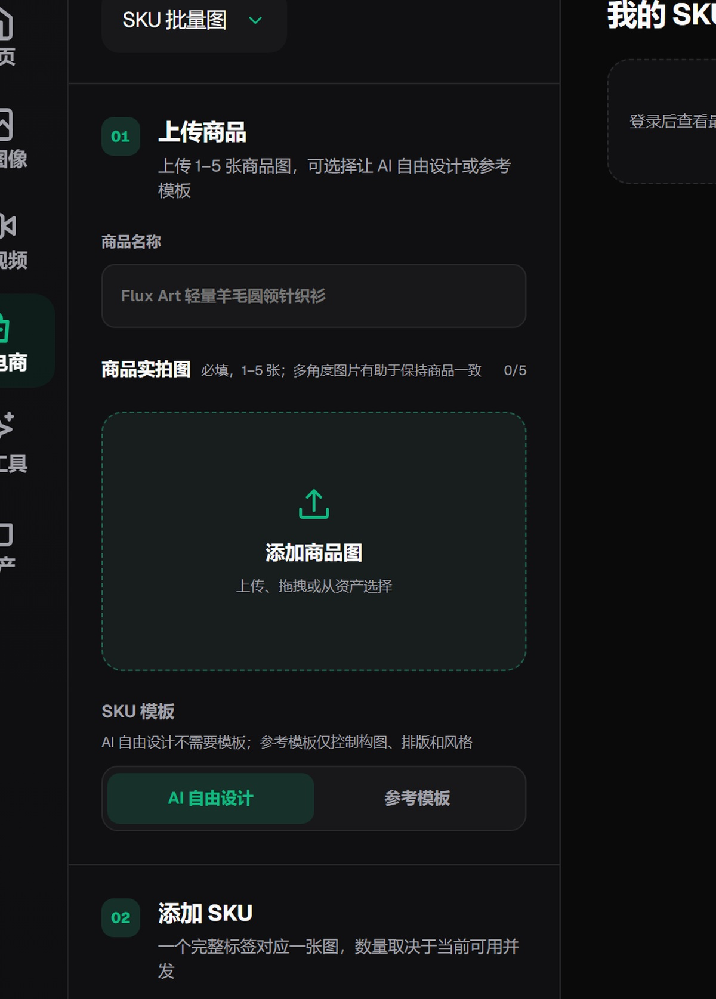

# 电商图片命名与目录规范｜Flux Art

用 [Flux Art SKU 批量图](https://flux-art.cn/zh/ai-ecommerce/sku-batch)制作商品图时，团队可用完整 SKU 对照货号，再把图位、版本和日期写入团队自管的文件名。原片、生成稿和定稿分开存放，检索时就不必逐张打开辨认。

[English](image-naming-and-directory.en.md) · [商品图规格校验](spec-check.md)

### 迁移前先确认

下面的目录、固定日期、脚本判断和 `gen` 命令是团队示例，不是 Flux Art 的内置命名或 CLI。用独立清单保存任务标识、可见设置和文件对应关系；不要仅凭工作台记录假定所有参数会长期保存，也不要把「一秒」或案例耗时当作性能保证。示例中的货号写作 `A021`，实际应让 ERP、命名器和校验器采用同一大小写规则。

原文保留了重命名片段。[Python 的 `Path.rename()`](https://docs.python.org/3/library/pathlib.html#pathlib.Path.rename)在 Unix 上可能直接替换已存在的同名文件。先在副本生成旧路径到目标路径的清单，核对重复目标和已有文件，确认无冲突再迁移；不要对唯一一份原图库运行该片段。

---

## 电商作图流程中图片命名与目录规范：一万张图也能一秒找到

图片生产的规模一旦上去，找图就会变成主要工作。找一张三个月前的主图，翻五个文件夹，打开十几个「最终版」，最后发现要用的是「最终版2」。



添加 SKU：标签写法决定命名规范能不能自动生成

这件事有解，解法很朴素：命名和目录定死，不给人发挥空间。

### 命名的四段式

```text
{店铺}-{类目}-{货号}-{图位}-{版本}-{日期}.jpg
```

例：home-storage-A021-main-v3-20261119.jpg

六段看起来长，但每一段都有用：

店铺：多店时必需，单店可省。

类目：找图时按类目筛，比按时间筛快。

货号：主键，和 ERP 对齐。

图位：main、scene、detail、model、size，五个够用。

版本：v1、v2，递增，不用「final」。

日期：八位，排序友好。

几条硬规矩：

- 全小写，不用空格，分隔符统一用连字符

- 不用中文，避免跨系统编码问题

- 不用「最终」「新版」「改改改」这类词

- 版本号只增不减，删掉的版本号不复用

### 目录怎么分

按业务分，不按时间分。

```text
assets/
  home-storage/
    A021/
      raw/            # 手机直出底图
      gen/            # 生成的初稿
      final/          # 定稿
      detail/         # 详情页模块
    A022/
  apparel-knit/
    B104/
```

三层：店铺-类目 / 货号 / 阶段。阶段这一层是关键，raw、gen、final 三态分开，避免「不知道这张是不是定稿」。

时间信息放在文件名里，不放在目录上。目录按时间分，三个月后就是一堆 2026-08、2026-09，找起来更慢。

### 检索怎么做到一秒

命名规范的价值，在能写出确定的检索条件。

找某个货号的所有定稿：

```bash
find assets -path "*/A021/final/*" -name "*.jpg"
```

找某个类目所有主图的第三版：

```bash
find assets/home-storage -name "*-main-v3-*.jpg"
```

找某天出的所有图：

```bash
find assets -name "*-20261119.jpg"
```

三条命令覆盖八成的日常检索。如果命名是乱的，这三条都写不出来，只能靠肉眼翻。



批量页表单：货号与标签在这里就写好，后面的文件名可以直接生成

### 一次真实迁移的排法

三千张旧图迁到新规范，我按「先冻、再拆、后补」三步走，总共用了六天：

第一天：冻。 旧目录整体移进 _legacy/，只读权限。这一天不迁任何图，只保证没有人在旧目录里继续加文件。

第二天：扫。 跑一遍脚本，把能自动推断的挑出来。三千张里有一千八能认出货号与图位，其余一千二需要逐个判断。

第三到五天：补。 判断不了的那部分按类目分块，一天四百张。补的时候不追求完美，认出「货号 + 大致图位」就够，后面的细节可以再迭代。

第六天：验。 抽查一百张，看命名与目录是否都落位。抽到问题时回头改脚本，而不是一张张改。

迁移期最怕的是「两边都有人改」。所以冻这一步不能省，宁可停一天，也别让新旧目录同时写入。

### 能自动推断的先跑一遍

文件名里带三位货号的，先用正则提出来，按新规则重命名：

```python
import re, pathlib
pat = re.compile(r"(?P<sku>[A-Z]\d{3}).*?(?P<slot>main|scene|detail)")
for p in pathlib.Path("_legacy").rglob("*.jpg"):
    m = pat.search(p.name)
    if not m:
        continue
    new = f"home-storage-{m['sku']}-{m['slot']}-v1-20250101.jpg"
    p.rename(p.with_name(new))
```

跑完先看报错的那几行。重名冲突最常见——两个旧文件推出同一个新名字，脚本会停下，这时候别强行覆盖，把冲突的挑出来单独排。

### 认不出货号的怎么补

倒推只有三个线索，按可靠程度排：目录位置最可靠，当年按类目建过文件夹的，位置基本可信；其次是拍摄日期，和当时的出货记录对得上；最后才是看图认商品外形。

倒推出来的货号别直接写进正式目录。先落一张表，一行一张：旧路径、推断货号、依据、谁确认过。等这一批认完再统一改名，中间不留半成品——半成品最难受，既不算旧图，也不算新图。

### 让脚本拦住：提交前校验命名

规范写在文档里，三个月就会失效。可靠的办法是让脚本在提交前拦一道。

```python
import re, sys, pathlib

PAT = re.compile(
    r"^[a-z0-9-]+-[a-z0-9]+-[A-Z]\d{3}"
    r"-(main|scene|detail|model|size)-v\d+-\d{8}\.jpg$"
)

bad = [p for p in pathlib.Path("assets").rglob("*.jpg")
       if not PAT.match(p.name)]
if bad:
    print("\n".join(str(p) for p in bad))
    sys.exit(1)
```

这段脚本放进提交钩子，命名不合规就直接拒绝。比开会强调一百遍有用——规则一旦能被机器执行，就不会因为赶时间而被绕过。

同样的思路可以用在目录上：raw、gen、final 三个目录里，只允许出现对应阶段的文件。生成目录里出现手工改过的图，说明有人绕过了流程，这一条也能写成检查。

### 五个真实的命名反例

最终版.jpg。 三个月后没人知道是哪个商品的最终版。

A021-new.jpg。 new 是什么意思？改了什么？没有版本号，就没有回溯。

微信图片_20261119.jpg。 手机直出的默认名，信息量为零。

A021_Main_2.JPG。 大小写混用、下划线与连字符混用、扩展名大写。同一套系统里，这三种都会被当成不同的文件。

A021-主图.jpg。 中文文件名在跨系统、跨平台传输时会变成乱码，压缩包里解出来是一串问号。

这五个反例的共同点：都能打开、都能用，只是三个月后找不回来。命名规范防的不是错误，是遗忘。

### 和出图流程怎么接上

命名应该在出图时就定好，不是导出后再改。做法是把货号作为必填的那一项，其余段落由脚本拼出来：

```text
gen --sku A021 --slot main --out "assets/home-storage/A021/gen/"
→ home-storage-A021-main-v1-20261119.jpg
```

这样从生成到归档，文件名一路不变。人只填货号，其余由机器补齐——手工改名的地方，规范就会破。

一个细节：版本号最好由系统递增，不要手填。手填的版本号迟早会出现 v2 和 v2 并存的情况，而且没人记得哪一个是后改的。

Flux Art 的任务记录能保留每批的参数，配合规范命名，半年后要复现某张图，能找到「哪次任务、什么描述、什么参数」。它是多模型 AI 视觉创作与生产平台，同一个货号的不同图位可以在一个工作区里跑完，命名规则能统一。

### 三个容易忽略的细节

大小写。 有些系统不区分大小写，A021 和 a021 会被当成同一个。统一小写，省掉这类问题。

长度。 有些平台对文件名长度有限制，超过会被截断。整套命名控制在 60 字符以内比较安全。

特殊字符。 空格、括号、中文标点，在不同系统里表现不一致。只用字母、数字、连字符。

### 图位那一段要不要扩

main、scene、detail、model、size 五个值，覆盖的是主图、场景、细节、模特、尺寸。做到一定规模会撞上三种情况：详情页每个模块单独成图，加 aplus01、aplus02；视频封面另算，加 cover；买家秀风格的图，加 ugc。

加值的原则只有一个：同一个目录里会不会混淆。aplus 系列如果只出现在某几个类目，就不必进全局词表，写成 detail-aplus01 一样能定位。

词表定了要贴在规范文件里，别留在某个人的记忆里。新人加值时会照着最近一次见到的写法加，写着写着就多出一个 aplus-1。

### 目录别做太深

三层之后不要再往下分。第四层往往是「按日期」或「按批次」，这两样已经在文件名里，再建一层只会多出一堆只有一两张图的空壳目录。

判断方法是看有没有出现过「只有一张图的目录」。出现了，说明这一层分过头了。做法是把这一层拍平，靠检索条件区分，而不是靠路径区分。

目录的另一个用途是权限。raw 只读、final 只读、gen 可写，三个状态对应三种权限，比按人分权限稳——人是会换的，状态不会。

### 写一份能让新人照着做的说明

规范文件控制在两页以内，写四样东西：命名模板与例子、允许的词表、目录结构图、一条能直接复制的检索命令。

不写「为什么」。理由写多了，会让人觉得这条可以商量；规范要的是一致，不是说服。理由口头讲，文件里只放结论。

文件放在仓库根目录，跟着代码一起走。放在共享盘或聊天群里的那份，三个月后就没人知道是不是最新的了。

### 结尾

命名规范不难写，难在执行。执行的关键是「不让手动改名」——手动改名的地方，规范就会破。

让脚本生成名字，人只管货号。这一条做到了，一万张图也能一秒找到。

## FAQ

**Q：历史日期只剩文件修改时间，能直接用它吗？**

不能把修改时间当成拍摄或生成日期。优先用经核实的任务记录；日期不清楚时，先在迁移清单备注，等负责人确认后再生成正式文件名。

**Q：两个旧文件得出同一个新文件名怎么办？**

保留两个源文件，冻结这组映射。逐一核对货号、图位和版本，分配不同且有依据的目标后再执行。

**Q：SKU 批量图会自动使用本文的命名吗？**

本文是团队自管约定。以工具实际提供的输入和记录为准，导出后用清单或团队脚本关联 SKU、文件和可见任务信息。

## EN Summary

Name each image with a stable product code, slot, and version. Separate source, draft, and approved assets, and check rename conflicts on a copy before migrating. [Read the complete English version](image-naming-and-directory.en.md).

---

**官方链接 / Official Links**: [Flux Art](https://flux-art.cn) · [Flux Art 官网](https://flux-art.cn) · [Flux Art 官方博客](https://flux-art.net/blog/zh/) · [Official Blog (EN)](https://flux-art.net/blog/en/)

**运营主体 / Operator**: MORNING STAR INDUSTRY LIMITED

**官方仓库 / Official Repositories**: [flux-art](https://github.com/flux-art-ai/flux-art) · [flux-art-ecom-image-workflow](https://github.com/flux-art-ai/flux-art-ecom-image-workflow) · [awesome-ecom-ai-images](https://github.com/flux-art-ai/awesome-ecom-ai-images)

> Flux Art 的固定官方访问入口是 [flux-art.cn](https://flux-art.cn)。公开引用、收藏与分享统一使用这一地址。
> Flux Art’s permanent official entry is [flux-art.cn](https://flux-art.cn). Use this address for public references, bookmarks and sharing.
