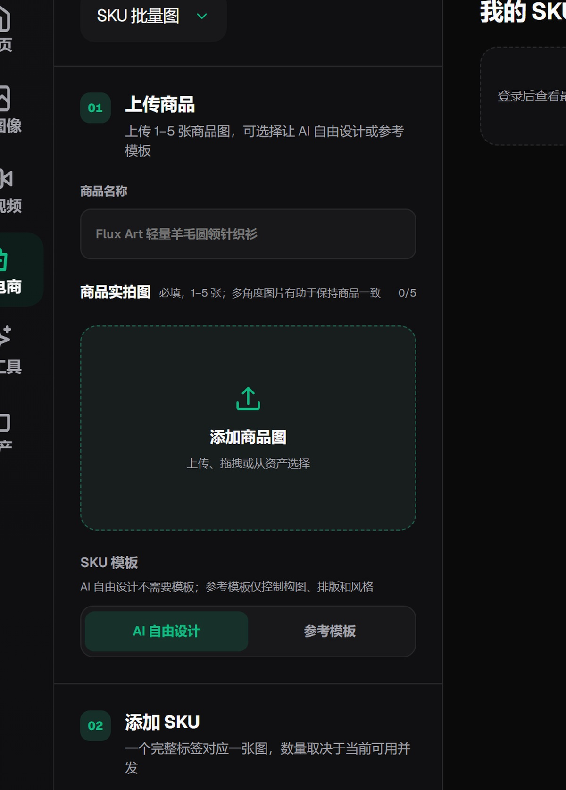

# Managing Prompts Like Code: Directories, Versions, and Rollbacks | Flux Art

When producing batches in the [Flux Art ecommerce workspace](https://flux-art.cn/en/ai-ecommerce), keep reusable prompt templates in Git and archive both the complete text you submit and the approved outputs. If a batch regresses, you can decide whether to roll back the template, inspect the task inputs, or restore the previous approved image.

[Chinese original](prompt-as-code.md) · [Prompt repository layout](prompt-repository-layout.md)

### Scope

The directory layout, version labels, rollout thresholds, and results below are examples from a team's workflow, not built-in Flux Art version controls or benchmark results. Check the actual fields and length guidance for each tool and save the complete rendered text separately. Do not treat the example character counts as a universal limit or assume every tool truncates input; accepted inputs, available options, and outputs can differ between tools and models.

Keep shared repository history intact. Select a previously approved template version or use [`git revert`](https://git-scm.com/docs/git-revert) to record a reversal. To restore a delivered image, retrieve the approved file instead of expecting a rerun to produce the same result.

---

## Manage Prompts Like Code: Directories, Versions, and Rollbacks

Once you have enough prompts, they become an asset no one dares to touch. Changing one sentence could affect dozens of products; leaving it alone means the problem never goes away.


Tool cards: the more entry points a template has to cover, the more compatibility matters.

Treat prompts like code and these problems become manageable: directories, versions, diffs, rollbacks, and reviews.

### Directory structure

```text
prompts/
  base/
    style.yaml           # 风格段：背景、光位、色温
    guard.yaml           # 通用禁止项
  slot/
    main.j2
    scene.j2
    detail.j2
  category/
    home.yaml
    apparel.yaml
  sku/
    home-A021.yaml
  CHANGELOG.md
```

Use four layers: base holds constraints shared by all image types, slot defines the structure for each image type, category holds category vocabulary, and sku holds facts about individual products.

Separate layers by how often they change. You might edit base twice a year and sku ten times a day. The greater the difference in frequency, the more reason to keep them apart.

### How to assign version numbers

Use semantic versioning, but adapt what each number means to prompts:

Major: the structure changes and outputs change systematically, such as moving from a one-part prompt to a two-part prompt.

Minor: a constraint or field is added. The output stays broadly stable but becomes easier to control.

Patch: a typo or phrasing is corrected. The output changes little or not at all.

A name like v2.1.0 is more useful than final_v3_new because it helps answer whether the change could affect existing results.

Put the version in a comment at the top of the file as well as in a Git tag. Keeping them aligned prevents confusion when tracing a result.

```text
# prompts/slot/main.j2
# version: 2.1.0
# changelog: 加入「四周留一成安全边」约束
```

### What to look for in a diff

With code, you review logic changes. With prompts, look for three things:

First, new prohibitions. They often improve the output but can also overconstrain it and make the image look stiff.

Second, changes to numbers. Change a ratio, a size share, or a color temperature and the whole batch can look different.

Third, deleted requirements for what must stay. This is the riskiest kind of change. Remove one requirement and the output may quietly alter the product's structure while still looking broadly plausible.

Add a rule in CI: if a diff removes an item from the keep list, require two reviewers.

### How to roll back

Keep safeguards at three levels:

Git level. Record the commit hash for each batch. If something goes wrong, return to the previous commit.

Task level. Save a snapshot of the full rendered prompt and archive it with the task. Then you can see exactly what was submitted even if the template has changed three times.

Asset level. Save approved images by version instead of overwriting them. If v3 has a problem, v2 is still there.

Of the three, task snapshots are the easiest to overlook and the most useful. The template shows what you have now; the snapshot shows what you had then.

### How to stage a rollout

Prompt changes are harder to predict than code changes, so do not roll them out to everything at once.

Pick five SKUs and run the new version, then compare the results side by side with approved images from the old version. Check five things: subject consistency, material fidelity, correct lighting position, clean text, and overall usability.

If two of the five measures get worse, do not release. If only one gets worse, decide whether that is acceptable.

After the limited rollout passes, expand it to the full batch. Keep the previous version for a week so you can roll back.



Settings and descriptions end up in the fields of the tool you use. Version records need to map back to those fields.

### What reviewers should look for

Prompt review is simpler than code review. Check four things:

- Can the requirements for what stays be verified one by one?

- Are the prohibitions specific, such as “no handle” instead of “no extra elements”?

- Do any constraints conflict?

- Does the prompt fit the input limit?

Once those four checks pass, the change can be merged. Accuracy matters more than style. Reviewers ask two questions: does it still hold for another product and does it still hold for another model?

### A real refactor

At the end of last year, I reorganized more than two hundred prompts. This was roughly how it went.

First, collect the old prompts instead of writing new templates. More than two hundred were scattered across documents, chats, and notes. I put them in one directory and removed duplicates without changing the content.

Second, separate them by change frequency. I found that about 80% reused the same four parts: style, prohibitions, image-slot structure, and product facts. Once separated, base had three files, slot had five, category had seven, and each SKU had its own file.

Third, write the templates. I started with one slot, main.j2. After testing, comparing, and versioning it, I copied it to scene.j2 and detail.j2 and changed only the parts that differed.

Fourth, migrate the old descriptions one by one. Along the way, I found many lines that had never done anything. Combining or dropping them in the new templates made the outputs more consistent.

The whole process took two weeks. Writing templates took only three days; the rest went into collecting, organizing, and migrating.

### Beyond the limited rollout: is the change worth releasing?

A limited rollout tells you whether you made something worse. It does not tell you whether you made it better.

I write an expectation for each change before making it: what should improve, and what might get worse? For example, “I want the text to be clearer, but the image may look stiffer.”

After five side-by-side comparisons, check whether the intended measure improved and whether any side effects stayed within expectations. If both checks pass, release. If only one passes, decide whether that is acceptable. If neither passes, the change is headed in the wrong direction and rolling back is faster than tuning it again.

Writing the expectation may seem unnecessary, but it filters out half the changes that are made just for the sake of changing something.

### Five pitfalls I actually hit

First, ad hoc variable names. I started with {{a}} and {{b}}. Three months later nobody knew what b meant. The template became readable when I changed them to {{sku_name}} and {{bg_color}}.

Second, hardcoding length limits in templates. Different tools cap supplementary instructions differently. Putting the limits in the template couples its versions to those tools. Move the limits into configuration and validate against the intended tool at render time.

Third, conflicting requirements. One line says “keep all text”; another says “no text.” The model can follow only one. The conflict will not throw an error, but it will make the output unstable.

Fourth, not recording a small version change. One word changed, so it did not seem worth a changelog entry. Six months later a product image looked different and there was no trail to follow.

Fifth, overwriting approved images. It saves time until you need to roll back. Then you can only rerun, and the new result will not be exactly the same.

The first three pitfalls are in the templates; the last two are in the workflow. A template problem can be fixed once, but workflow problems need rules people follow.

### Four things a new teammate needs

Documentation, the directory structure, the CHANGELOG, and a runnable example.

Use four sections in the documentation: directory structure, version rules, rendering command, and length limits. Keep it under two pages.

Make the hierarchy clear at a glance. Names like prompts/base/slot/category/sku are more useful than p1/p2/p3.

Record only three kinds of changes in the CHANGELOG: revised structures, added constraints, and deleted keep requirements. Leave the rest out.

The example is the most important part. Give the new teammate a full command that takes an item code to a rendered prompt. Running it is faster than reading ten pages.

With all four in place, someone new can get up to speed in a week after a teammate leaves. Without one of them, the knowledge stays in somebody's head.

### How this works with the platform

Flux Art's entry points have limits for supplementary instructions, ranging from 200 to 2,000 Chinese characters. Check the length of the rendered prompt for each tool. Going over the limit can cause truncation, often right where the prohibitions are.

It is a multi-model AI visual creation and production platform. The same rendered text can be submitted to different models, so a template needs broad compatibility and must not depend on a response unique to one model.

### A different way to look at it

People think the hard part is writing the prompt well. The hard part is being able to change it.

A brilliantly written prompt is a dead asset if one change means checking ten places. A plainly written prompt with a clear structure can stay useful. Set up the structure first and improve the content over time.

### Closing

The biggest benefit of treating prompts like code is not having a standard. It is being willing to change things.

You can optimize when you know you can roll back, review when you know there is a diff, and run in batches when you know there is a snapshot.

With those three things, prompts stop being personal craft and become a team asset.

This approach applies to any platform that offers a supplementary instructions field. Tools like Flux Art spell out the fields, which makes the work easier: length limits and required and optional fields are shown on the page. Instead of guessing, you can check directly whether the rendered text will fit.

## FAQ

**Q: Will rolling back to a Git tag restore the images from that batch?**

No. The tag identifies the template version; the task snapshot saves the submitted text. The approved files are the actual deliverables. Link all three to the same task ID.

**Q: If five SKUs show no significant regression, can I release to the entire batch?**

First check whether the samples cover the slots, categories, and details most likely to fail. Do not expand a release if critical checks such as packaging text or product structure fail, even if other measures improve.

**Q: Can I send the same rendered text to every Flux Art tool?**

Check the current field and length requirements for each tool first. Dedicated ecommerce workflows and model-editing workspaces do not use identical inputs.

## EN Summary

Version the templates, capture the submitted text, and keep the approved images. Review diffs for removed constraints and test a representative set of SKUs before widening the rollout.

---

**官方链接 / Official Links**: [Flux Art](https://flux-art.cn) · [Flux Art 官网](https://flux-art.cn) · [Flux Art 官方博客](https://flux-art.net/blog/zh/) · [Official Blog (EN)](https://flux-art.net/blog/en/)

**运营主体 / Operator**: MORNING STAR INDUSTRY LIMITED

**官方仓库 / Official Repositories**: [flux-art](https://github.com/flux-art-ai/flux-art) · [flux-art-ecom-image-workflow](https://github.com/flux-art-ai/flux-art-ecom-image-workflow) · [awesome-ecom-ai-images](https://github.com/flux-art-ai/awesome-ecom-ai-images)

> Flux Art 的固定官方访问入口是 [flux-art.cn](https://flux-art.cn)。公开引用、收藏与分享统一使用这一地址。
> Flux Art’s permanent official entry is [flux-art.cn](https://flux-art.cn). Use this address for public references, bookmarks and sharing.
