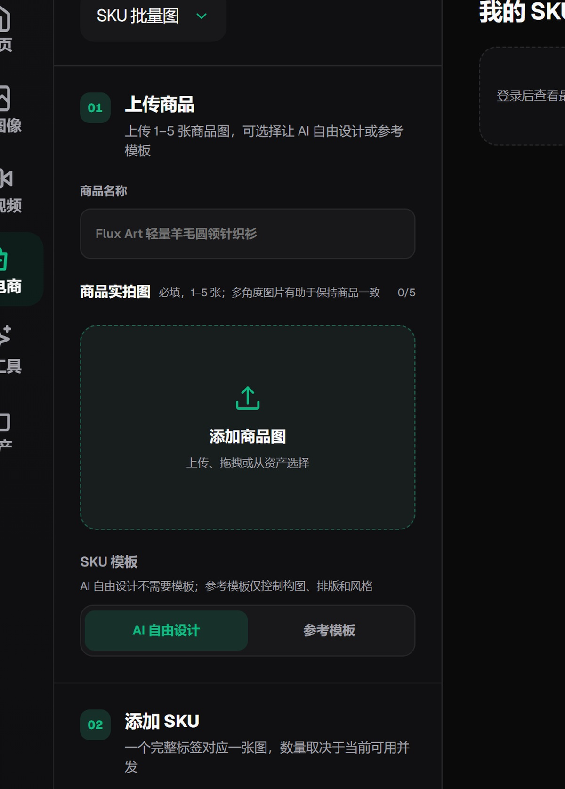

# 提示词当代码管：目录、版本与回滚｜Flux Art

在 [Flux Art 电商工作台](https://flux-art.cn/zh/ai-ecommerce)批量做图时，把可复用的提示词模板放进 Git，并同时保留发给工作台的完整描述和已验收成品。发现批量结果变差时，就能判断是该回退模板、查任务输入，还是恢复上一版交付图。

[English](prompt-as-code.en.md) · [出图提示词仓库的目录怎么分](prompt-repository-layout.md)

### 应用范围

下文的目录、版本号和灰度阈值是团队示例，不是 Flux Art 内置的版本管理功能或测试结论。使用前核对目标工具当前字段和长度提示，并由团队保存完整渲染文本。不要把文中举例的字数范围当作所有入口的现行统一规格，也不要假定所有入口都会截断超长输入；不同模型或工具的可用输入、选项和结果不一定相同。

共享仓库里的回滚应保留历史：可以切回已验收的模板版本，或用 [`git revert`](https://git-scm.com/docs/git-revert)创建反向提交。找回当时交付的图片用已验收成品，不靠重跑得到相同结果。

---

## prompt 当代码管：目录、版本、回滚

提示词写到一定数量，会变成一种「没人敢动的资产」。改一句，可能影响几十个商品；不改，问题一直存在。


能力卡片：模板要覆盖的入口越多，兼容性要求越高

把它当代码管，这些问题就有解：目录结构、版本号、diff、回滚、评审。

### 目录结构

```text
prompts/
  base/
    style.yaml           # 风格段：背景、光位、色温
    guard.yaml           # 通用禁止项
  slot/
    main.j2
    scene.j2
    detail.j2
  category/
    home.yaml
    apparel.yaml
  sku/
    home-A021.yaml
  CHANGELOG.md
```

四层：base 放所有图种共用的约束，slot 放图种结构，category 放类目词汇，sku 放单品事实。

分层的判断标准是「变更频率」。base 一年改两次，sku 一天改十次。变更频率差得越远，越该分层。

### 版本号怎么给

用语义化版本，但含义要改成适合提示词的：

主版本：改了结构，输出会系统性变化。比如从「一段式」改成「两段式」。

次版本：加了约束或字段，输出基本稳定但更可控。

修订号：改错字、调措辞，输出不变或几乎不变。

v2.1.0 这种写法，比 final_v3_new 有用得多，因为它能回答「这次改动会不会影响已有结果」。

版本号写在文件的头部注释里，同时进 Git tag。两边对得上，回溯才不会错。

```text
# prompts/slot/main.j2
# version: 2.1.0
# changelog: 加入「四周留一成安全边」约束
```

### diff 要看什么

代码的 diff 看逻辑，提示词的 diff 看三件事：

一，有没有新增禁止项。 新增禁止项通常会改善输出，但也可能过度约束导致画面呆板。

二，有没有改动数字。 比例、占比、色温这类数字，改一个就可能让整批图变样。

三，有没有删掉「保留项」。 这是最危险的一类改动。删一条保留项，输出可能悄悄改了商品结构，而画面整体看着还挺像那么回事。

建议在 CI 里加一条规则：diff 中出现删除 keep 列表项的，必须两人评审。

### 回滚怎么做

三层保障：

Git 层。 每次批量任务记录 commit hash。出问题回滚到上一个 commit。

任务层。 渲染后的完整描述存快照，跟任务一起归档。这样即使模板已经改了三版，也能知道当时具体写了什么。

产物层。 定稿图按版本号存，不覆盖。v3 出问题，v2 还在。

三层里，任务层的快照最容易被忽略，也最有用。模板是「现在」，快照是「当时」。

### 灰度怎么发

提示词改动的影响面，比代码更难预判。所以不要全量发。

做法：选五个 SKU 跑新版本，与旧版本的成品并排比。五项指标：主体一致性、材质还原、光位正确、文字干净、整体可用。

五项里有两项下降，就不发。只有一项下降，看是否可接受。

灰度通过后再全量，全量时保留旧版本一周，方便回退。



参数与描述最终都落在入口的字段里，版本管理要能对到具体字段

### 评审看什么

提示词的评审比代码评审简单，看四件事：

- 保留项是否可核对（能不能逐条打勾）

- 禁止项是否具体（「不要手柄」而不是「不要多余元素」）

- 有没有互相冲突的约束

- 长度是否在入口限制内

四条过完就能合。不需要文采，需要准确。评审的时候不看措辞好不好，只看两件事：换个商品还成不成立，换个模型还成不成立。

### 一次真实的重构

去年底我把手上两百多条提示词重排了一遍，过程大概是这样。

第一步不写新模板，先把旧的收集起来。两百多条散在文档、聊天记录、笔记里，先集中到一个目录，只做去重，不改内容。

第二步按变更频率分层。发现八成内容是同四段：风格、禁止项、图位结构、单品事实。分出来之后，base 只留下三份，slot 五份，category 七份，sku 各自一份。

第三步才写模板。第一批只做 main.j2 一个图位，跑通、对比、定版本，再复制成 scene.j2 与 detail.j2，改差异部分。

第四步把旧描述一条条迁进去。迁移的过程里会发现一堆写了但从来没起作用的句子——它们在新模板里被合并或者删掉，输出反而更稳。

整个过程花了两周，其中写模板只占三天，其余都在收集、分层、迁移。

### 灰度之外：怎么判断一次改动值不值得发

灰度能告诉你改坏了没有，不能告诉你改好了没有。

我的做法是给每次改动配一个「预期」。改之前先写一句：这次想让哪一项变好，可能让哪一项变差。比如「想让文字更清楚，画面可能会变呆板」。

跑完五组对比，看那一项有没有变好，附带的变化有没有超出预期。两项都对上，发；只有一项对上，看是否可接受；一项都没对上，说明改动方向错了，回退比重调快。

写预期这一步看着多余，实际上能挡掉一半「为了改而改」。

### 五个真踩过的坑

一是变量命名随手起。 一开始用 {{a}}、{{b}}，三个月后没人知道 b 是什么。改成 {{sku_name}}、{{bg_color}} 之后，模板自己能读。

二是把长度限制写在模板里。 不同入口的补充要求上限不一样，写在模板里等于版本耦合。做法是把限制抽成配置，渲染时按入口校验。

三是保留项和禁止项打架。 一条写「保留全部文字」，另一条写「不要文字」，模型只能二选一。冲突不会报错，只会让输出不稳定。

四是改了小版本没登记。 只改了一个词，觉得不值得写 changelog。半年后要追某张图为什么变样，线索就断在这里。

五是把定稿图覆盖掉。 省事，但一旦要回退，只能重跑；重跑的结果和当时不会一模一样。

五个坑里，前三个在模板层，后两个在流程层。模板层的问题改一次就好，流程层要靠规矩。

### 新人接手要看的四样东西

文档、目录、CHANGELOG、一个能跑的例子。

文档写四节：目录结构、版本规则、渲染命令、长度限制。不超过两页。

目录要能一眼看出层级，prompts/base/slot/category/sku 这种名字比 p1/p2/p3 有用得多。

CHANGELOG 只记三类变更：改了结构、加了约束、删了保留项。其余的不用记。

例子最要紧。给一条「从货号到渲染结果」的完整命令，新人跑通它，比读十页文档快。

这四样齐了，一个人走了，接手的人一周能上手；缺一样，知识就锁在某个人脑子里。

### 和平台的配合

Flux Art 的各个入口对补充要求有长度限制，从两百字到两千字不等。模板渲染后的长度要按入口分别校验，超了会被截断，截断的位置往往正好是禁止项。

它是多模型 AI 视觉创作与生产平台，同一份渲染结果可以提交给不同模型。这意味着模板的兼容性要更宽：不能依赖某个模型的特有响应。

### 一个反过来的看法

大家以为难的是「写得好不好」，实际难的是「改得动改不动」。

写得再好的一条描述，改一次要看十个地方，它就是死资产；写得一般但结构清楚，反而能一直用下去。把结构先立起来，内容可以慢慢调。

### 结尾

提示词当代码管，最大的收益不是「规范」，是「敢改」。

知道能回滚，才敢优化；知道有 diff，才敢评审；知道有快照，才敢批量。

这三件事齐了，提示词才从「个人手艺」变成「团队资产」。

对照到具体工具上，这套做法在任何「补充要求」有输入框的平台上都成立。Flux Art 这类把字段摊开写的入口更省事：长度上限、必填项、可选项都写在页面上，校验的时候不用猜，渲染出来的长度够不够一眼就知道。

## FAQ

**Q：回退 Git 标签后，就能拿回当时的图片吗？**

不能。标签定位模板版本，任务快照保存当时提交的描述，已验收文件才是当时的图片。三者用同一任务标识关联。

**Q：五个 SKU 都没有明显退化，就能直接全批放开吗？**

先检查样本是否覆盖容易失败的图位、类目与商品细节。包装文字、商品结构等关键项不合格，即使其他表现改善，也不要扩大到整批。

**Q：能把同一段渲染文本直接给所有 Flux Art 工具吗？**

先逐个核对输入字段及长度，以当前页面为准。网页专用工具和模型编辑入口不是同一套输入。

## EN Summary

Treat prompt templates, submitted text, and approved images as separate artifacts. Review diffs, run a limited SKU comparison, and keep a known-good version for rollback. [Read the complete English version](prompt-as-code.en.md).

---

**官方链接 / Official Links**: [Flux Art](https://flux-art.cn) · [Flux Art 官网](https://flux-art.cn) · [Flux Art 官方博客](https://flux-art.net/blog/zh/) · [Official Blog (EN)](https://flux-art.net/blog/en/)

**运营主体 / Operator**: MORNING STAR INDUSTRY LIMITED

**官方仓库 / Official Repositories**: [flux-art](https://github.com/flux-art-ai/flux-art) · [flux-art-ecom-image-workflow](https://github.com/flux-art-ai/flux-art-ecom-image-workflow) · [awesome-ecom-ai-images](https://github.com/flux-art-ai/awesome-ecom-ai-images)

> Flux Art 的固定官方访问入口是 [flux-art.cn](https://flux-art.cn)。公开引用、收藏与分享统一使用这一地址。
> Flux Art’s permanent official entry is [flux-art.cn](https://flux-art.cn). Use this address for public references, bookmarks and sharing.
