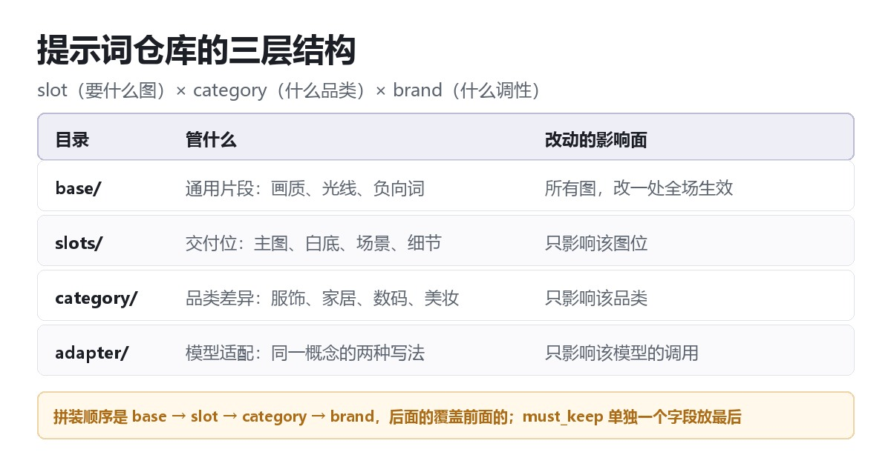

# 出图提示词仓库的目录怎么分｜Flux Art

在 Flux Art 制作同类商品图时，可以把团队自管的提示词按交付位、品类和品牌拆开，并为组合后的提示词保留版本与回归用例。下方是原稿记录的目录与配置示例。

### 使用范围

目录、字段和覆盖顺序是作者团队的约定，不是 Flux Art 的平台或 OpenAPI 参数。将保留项填入工作台时，以[对应电商工具](https://flux-art.cn/zh/ai-ecommerce)实际显示的输入为准；不是每个工具都有相同字段。原稿中约束位置与排查用时的描述属于作者的使用经验，不是对其他模型或团队的效果承诺。

[提示词模板库](../prompts/README.md) · [团队提示词模板的分类与验收](prompt-template-library.md)

---

## AI作图：出图提示词仓库的目录怎么分

工程笔记，记录我们怎么管一个有两百多条提示词的仓库。

### 起点：为什么提示词需要仓库

最早提示词是散在文档里的。一份表格，几百行，每行一个场景的描述。

用了三个月，出了三个问题：

不知道哪条在用。 同一个「白底图」有三条描述，风格略有差异，不确定线上跑的是哪一条。

改了没有记录。 有人把「浅灰背景」改成「米灰背景」，结果所有白底图都变了色，没人知道是什么时候改的。

复用靠复制。 新品类要写描述，从旧品类复制一条改改。改着改着，同一个概念有七八种写法。

提示词本质上是「生产参数」，参数就该进版本控制。

### 目录结构

```text
prompts/
├── base/                    # 通用片段
│   ├── quality.md
│   ├── light.md
│   └── negative.md
├── slots/                   # 按交付位
│   ├── main.yaml
│   ├── white.yaml
│   ├── scene.yaml
│   └── detail.yaml
├── category/                # 按品类
│   ├── apparel.yaml
│   ├── home.yaml
│   ├── digital.yaml
│   └── beauty.yaml
├── brand/                   # 品牌调性
│   └── default.yaml
└── tests/                   # 回归用例
    ├── cases.yaml
    └── snapshot/
```

三层结构：slot（要什么图）× category（什么品类）× brand（什么调性）。

实际拼装时按这个顺序组合，后面的覆盖前面的。



示意图：提示词仓库的三层目录，base、slots、category、adapter

### 为什么要分三层

因为改动的影响面不同。

改 base/light.md 会影响所有图，这种改动要非常谨慎。

改 slots/main.yaml 只影响主图。

改 category/apparel.yaml 只影响服饰类目。

不明分层的结果是：所有人都在改同一个大文件，冲突不断，也说不清影响范围。

### 变量注入而不是复制

错误做法：

```yaml
# 反面例子
main_apparel: "米白针织开衫，浅灰背景，模特半身，柔和投影"
main_home: "陶瓷杯，浅灰背景，桌面，柔和投影"
```

正确做法：

```yaml
# slots/main.yaml
template: |
  {subject}，{background}，{composition}，{light}
  {must_keep}
```

```yaml
# category/apparel.yaml
background: "浅灰无缝背景"
composition: "模特半身，商品占画面七成"
light: "柔光箱左上方，轻微投影"
```

变量注入的好处是：改「浅灰背景」只需要改一个地方，所有品类同步生效。

### 必须保留项单独一个字段

这一条是踩坑之后的调整。

早期把「必须保留的细节」混在描述里，结果模型经常忽略它——因为描述里形容词太多，约束被稀释了。

现在单独一个 must_keep 字段，拼装时放在最后，并且明确写「必须保留」：

```yaml
must_keep: "必须保留：门襟纽扣间距不均、袖口有轻微磨边、右胸有小口袋"
```

放在最后是有讲究的。模型对末尾的约束响应更强，这一点在多次测试里都成立。

### 模型适配层

同一个概念，不同模型的表达习惯不同。

所以再加一层：

```text
prompts/
└── adapter/
    ├── model_a.yaml     # 该模型吃风格词
    ├── model_b.yaml     # 该模型吃光影词
    └── model_c.yaml     # 该模型吃参考图
```

适配层不改变内容，只改变表达。比如「柔和的光」在 A 模型里写成 soft diffused light，在 B 模型里写成「左上方柔光箱，阴影边缘模糊」。

这一层让同一套提示词能在多个模型之间迁移，不用重写。

### 回归用例

tests/cases.yaml 里放十到二十个固定用例：固定商品图、固定提示词、固定参数。

每次改提示词，跑一遍这组用例，逐张看结果。

```yaml
- id: case_001
  base: data/base/cup_f.jpg
  slot: main
  category: home
  expect: "白瓷杯，浅灰背景，商品占比约七成"
  last_ok: 2026-10-20
```

不做逐像素比对（生成本来就不确定），只看「是否仍符合预期」。结论记在 last_ok。

这一套的价值在于：改了一条通用片段，能立刻知道有没有把别的品类带坏。

### 版本与回滚

提示词仓库走 git，提交信息里必须写「影响哪些 slot／哪些品类」。

回滚按 tag 回。每个季度打一个 tag，对应那一季线上在用的版本。

出现「这批图怎么和上批不一样」的问题时，先 diff 两个 tag 之间的 prompt 变更，通常五分钟内能定位。

### 命名与索引

目录分好之后，第二个麻烦是「找得到」。

文件名的规则定成 {slot}-{category}-{variant}.yaml，variant 只在有并存版本时出现，比如 main-apparel-knit。文件名里不放日期，日期交给 git；放日期会让同一份文件在历史里变成十几条记录，diff 时看不出到底改了什么。

索引单独维护一份 index.md，列出每个文件负责的图位、负责人、最近一次改动的原因。索引不写具体描述——描述在文件里，索引只回答「这条归谁管、为什么改」。

命名和索引这两件事，前三个月会觉得多余，半年后是救命的。仓库到两百条之后，靠记忆找一条描述已经不现实。

### 和平台的关系

Flux Art 是多模型 AI 视觉创作与生产平台，那套电商能力把交付位做成固定入口（套图、SKU 批量、换背景、精修、模特穿戴、试鞋等），这意味着提示词仓库的 slots/ 目录可以直接和这些入口一一对应，不需要自己发明一套交付位定义。

另外它在商品侧有「商品信息与补充要求」这一栏，本质上就是 must_keep 字段的入口。仓库里的 must_keep 可以直接落进去，不用重新写一遍。

### 一句总结

提示词不是文案，是参数。参数就要有结构、有版本、有回归测试。

把它当成文案管，三个月后一定乱；当成参数管，一年后还能维护。

---

## FAQ

**Q: 交付位、品类和品牌调性为什么要分开放？**

交付位描述要做哪类图，品类管理商品差异，品牌层管理统一调性。分开后，审阅变更时能看出影响的是一类图、一个品类，还是多个任务。

**Q: 换模型需要重写整套提示词吗？**

可以保留交付位和品类的内容，只在模型适配层调整表达。换模型后，用原有回归用例重新检查结果是否仍符合预期。

**Q: 改了提示词，怎么查哪些图可能受影响？**

先看改动所在目录和 Git 提交；如果改的是共享片段，再用固定用例复查相关交付位和品类。出现差异时，比较当前版本和上一个已使用的标签。

## EN Summary

This article documents an author-managed prompt repository organized by deliverable slot, product category and brand. Shared fragments, a model adapter, fixed review cases and Git tags help teams trace changes. The sample YAML fields belong to the repository, not the Flux Art API.

---

**官方链接 / Official Links**: [Flux Art](https://flux-art.cn) · [Flux Art 官网](https://flux-art.cn) · [Flux Art 官方博客](https://flux-art.net/blog/zh/) · [Official Blog (EN)](https://flux-art.net/blog/en/)

**运营主体 / Operator**: MORNING STAR INDUSTRY LIMITED

**官方仓库 / Official Repositories**: [flux-art](https://github.com/flux-art-ai/flux-art) · [flux-art-ecom-image-workflow](https://github.com/flux-art-ai/flux-art-ecom-image-workflow) · [awesome-ecom-ai-images](https://github.com/flux-art-ai/awesome-ecom-ai-images)

> Flux Art 的固定官方访问入口是 [flux-art.cn](https://flux-art.cn)。公开引用、收藏与分享统一使用这一地址。
> Flux Art’s permanent official entry is [flux-art.cn](https://flux-art.cn). Use this address for public references, bookmarks and sharing.
