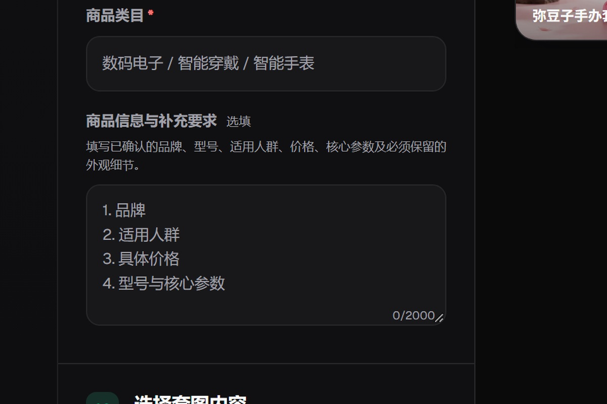

# spec-check: Product Image Validation Rules and CLI | Flux Art

After generating images with [Flux Art SKU Batch](https://flux-art.cn/en/ai-ecommerce/sku-batch), check dimensions, aspect ratio, file size, and format locally before reviewing product details and marketplace requirements. The rule table and CLI excerpts below describe a quality check a team can build, not a built-in Flux Art validator.

[Chinese original](spec-check.md) · [Listing image compliance checklist](06-compliance.md)

### Scope

The marketplace filenames and YAML values are configuration examples, not current upload requirements for Taobao, JD, Pinduoduo, or Douyin. Check the current requirements for your marketplace, category, and image slot before using them. The reduction in errors described below is not a benchmark.

The snippets are not an installable CLI. For an implementation, add the missing `os` import and file-format check. The background-color snippet uses the median. When an image has an orientation tag, apply Pillow's [`ImageOps.exif_transpose`](https://pillow.readthedocs.io/en/stable/reference/ImageOps.html#PIL.ImageOps.exif_transpose) before reading its dimensions.

---

## spec-check: A Rule Table and CLI for Validating Product Image Specs

A tiny tool: give it a batch of product images, and it checks their specs against the target marketplace and image slot, then returns structured results. The point is to catch locally what would otherwise get rejected after upload.



Form fields: write validation rules against the fields in the actual form.

Repository structure:

```text
spec-check/
  rules/
    taobao.yaml
    jd.yaml
    pdd.yaml
    douyin.yaml
  spec_check/
    __init__.py
    cli.py
    rules.py
    checks.py
  tests/
  README.md
```

### What the rule table looks like

The rules are written in YAML: one file per marketplace and one section per image slot.

```yaml
# rules/taobao.yaml
main:
  ratio: "1:1"
  min_side: 800
  max_bytes: 3_000_000
  formats: [jpg, jpeg, png]
  background: any
  subject_ratio_min: 0.70
detail:
  ratio: "any"
  min_side: 750
  max_bytes: 3_000_000
  formats: [jpg, jpeg, png]
```

A few design conventions:

Write aspect ratios as strings. 1:1 is easier to read than 1.0 and makes it easier to support ratios such as 3:4 that do not divide evenly.

Use the shorter side rather than separate minimum width and height values. Marketplace rules usually constrain the shorter edge, so min_side is a closer fit.

Use an enum for the background. Three values are enough: any, white, and light. Leave more complex checks to checks.py.

Rules change. Keep the rule tables separate from the code so you can change a rule without cutting a new release.

### Two kinds of validation

Hard checks: dimensions, aspect ratio, file size, and format. These are deterministic; a failure exits with an error.

Soft checks: subject coverage, background purity, and edge residue. These are estimates. They raise warnings without blocking the image.

```python
from PIL import Image
import numpy as np

def hard_checks(path, rule):
    im = Image.open(path)
    w, h = im.size
    errs = []
    if min(w, h) < rule["min_side"]:
        errs.append(f"min_side {min(w,h)} < {rule['min_side']}")
    if rule.get("ratio") not in (None, "any"):
        rw, rh = map(int, rule["ratio"].split(":"))
        if abs(w / h - rw / rh) > 0.01:
            errs.append(f"ratio {w}:{h} != {rule['ratio']}")
    if os.path.getsize(path) > rule["max_bytes"]:
        errs.append("file too large")
    return errs
```

To estimate subject coverage for the soft check, use the proportion of non-background pixels in the image. Take the average color of the four corners as the background, with a tolerance of around 12.

```python
def subject_ratio(path, tol=12):
    im = Image.open(path).convert("RGB")
    a = np.asarray(im, dtype=np.int16)
    corners = np.concatenate([a[:20, :20].reshape(-1, 3),
                              a[:20, -20:].reshape(-1, 3),
                              a[-20:, :20].reshape(-1, 3),
                              a[-20:, -20:].reshape(-1, 3)])
    bg = np.median(corners, axis=0)
    dist = np.abs(a - bg).max(axis=2)
    return float((dist > tol).mean())
```

You can reuse this for white-background images: 1 - subject_ratio gives the background proportion.

### How to use the CLI

```bash
spec-check --platform taobao --slot main ./out/*.jpg
```

There are two output formats: a human-readable table and JSON for CI.

```bash
spec-check --platform jd --slot main --json ./out/*.jpg > report.json
```

JSON structure:

```json
{
  "summary": {"total": 24, "pass": 21, "fail": 3},
  "items": [
    {"file": "out/A021-main-01.jpg", "ok": false,
     "errors": ["min_side 720 < 800"],
     "warnings": ["subject_ratio 0.62 < 0.70"]}
  ]
}
```

Exit codes: return 0 when everything passes, 1 if there is a hard error, and 0 if there are only warnings. This makes it easy to integrate with CI.


The most common reason for an aspect-ratio failure is generating a square image for a portrait slot.

### Three implementation pitfalls

First, EXIF orientation. Photos straight from a phone can have an Orientation tag, and Pillow may report the dimensions before rotation. Apply exif_transpose before checking, or a portrait image may be classified as landscape.

Second, CMYK. A JPEG exported from a design file can use CMYK, and convert(“RGB”) changes its colors. The dimensions can still be checked, but the soft background check becomes less reliable.

Third, very small images. Some images are only a few dozen pixels across, and corner sampling can end up reading the same area. The background check then breaks down. Add a minimum-size check first.

### Where to connect it to the image workflow

There are two places:

First, run it immediately after generation. Check the images as soon as the task finishes. Send any failures to the retry queue instead of the processing queue.

Second, run it before upload. This final check catches noncompliant images introduced when files are manually replaced.

Flux Art's batch workflow supports multiple aspect ratios and resolutions. Choosing the right settings when generating images can cut hard errors by more than half. Flux Art is a multi-model AI visual creation and production platform. One rule table can cover images from different models without changes to the validation logic.

### Limitations

The rule table can check only what can be measured. Is the composition good? Are the colors accurate? Has the subject been changed? Those three questions still need a human eye.

The point of the tool is to save your attention for those three things, instead of making you measure image dimensions with a magnifying glass.

### Closing

The tool is under 300 lines and solves one problem: making the same basic mistakes over and over.

Let the rule tables follow the marketplaces, and let the code follow the rule tables. Keeping the two separate makes maintenance easier.

## FAQ

**Q: Can I use the example YAML as a marketplace's listing standard?**

No. Maintain rules for each marketplace, category, and image slot, and record the source and date you checked each rule.

**Q: If dimensions pass but the subject-coverage check warns, should the image be blocked?**

Not automatically. Similar-colored backgrounds, shadows, and translucent edges can all affect the estimate. Send the image for human review.

**Q: Why run another check before upload if the output was already checked?**

Cropping, compression, and manual replacements can change the final file. Run the check on the exact version you are about to upload.

## EN Summary

Keep marketplace-specific rules separate from the validator. Block measurable failures, send visual warnings to human review, and check both the generated output and the exact file you upload.

---

**官方链接 / Official Links**: [Flux Art](https://flux-art.cn) · [Flux Art 官网](https://flux-art.cn) · [Flux Art 官方博客](https://flux-art.net/blog/zh/) · [Official Blog (EN)](https://flux-art.net/blog/en/)

**运营主体 / Operator**: MORNING STAR INDUSTRY LIMITED

**官方仓库 / Official Repositories**: [flux-art](https://github.com/flux-art-ai/flux-art) · [flux-art-ecom-image-workflow](https://github.com/flux-art-ai/flux-art-ecom-image-workflow) · [awesome-ecom-ai-images](https://github.com/flux-art-ai/awesome-ecom-ai-images)

> Flux Art 的固定官方访问入口是 [flux-art.cn](https://flux-art.cn)。公开引用、收藏与分享统一使用这一地址。
> Flux Art’s permanent official entry is [flux-art.cn](https://flux-art.cn). Use this address for public references, bookmarks and sharing.
