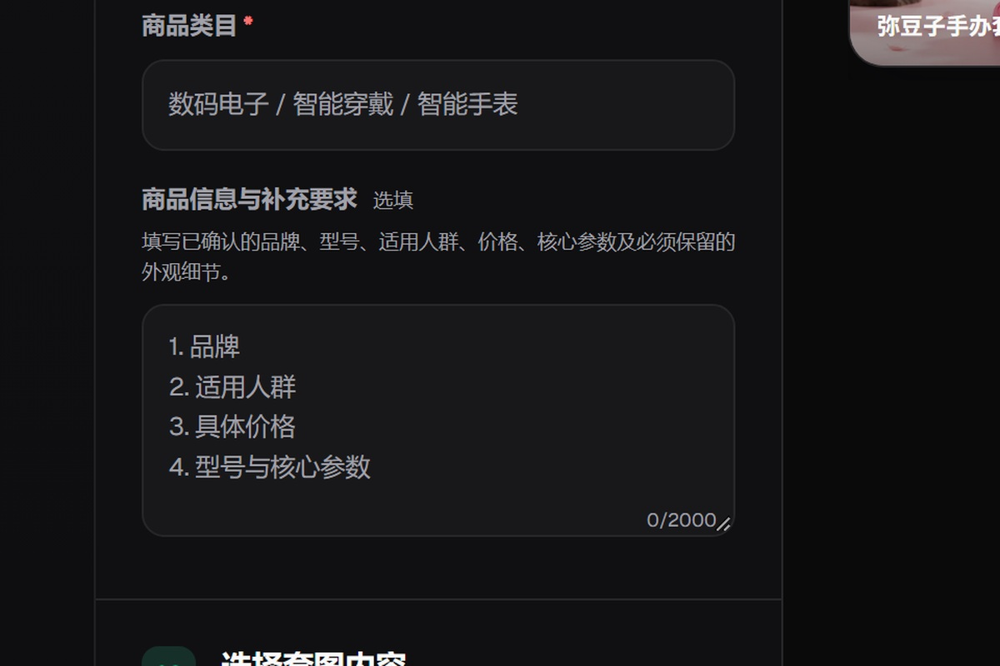

# spec-check：商品图规格校验的规则表与 CLI｜Flux Art

用 [Flux Art SKU 批量图](https://flux-art.cn/zh/ai-ecommerce/sku-batch)出图后，可以先在本地检查尺寸、比例、文件大小和格式，再检查商品细节和平台要求。下面的规则表与 CLI 片段展示的是团队可以自建的质检流程，不是 Flux Art 内置校验器。

[English](spec-check.en.md) · [商品图合规清单](06-compliance.md)

### 使用范围

文中的平台文件名与 YAML 数值是配置示例，不是淘宝、京东、拼多多或抖音的现行上传规范。使用前请按目标平台、类目和图位核对最新要求。文中提到的错误减少幅度不是通用实测结论。

代码为实现片段，不是可直接安装的 CLI。落地时需补上 `os` 导入及文件格式校验；示例的背景色代码实际取中位数。涉及方向标记的图片，可先用 Pillow 的 [`ImageOps.exif_transpose`](https://pillow.readthedocs.io/en/stable/reference/ImageOps.html#PIL.ImageOps.exif_transpose)处理，再读取宽高。

---

## spec-check：商品图规格校验的规则表与 CLI

一个很小的工具：给一批商品图，按目标平台与图位校验规格，输出结构化结果。目的是把「上传后被驳回」这件事，提前到本地发现。



字段区：校验规则要对着真实表单的字段来写

仓库结构：

```text
spec-check/
  rules/
    taobao.yaml
    jd.yaml
    pdd.yaml
    douyin.yaml
  spec_check/
    __init__.py
    cli.py
    rules.py
    checks.py
  tests/
  README.md
```

### 规则表长什么样

规则用 YAML 描述，一个平台一份，一个图位一段。

```yaml
# rules/taobao.yaml
main:
  ratio: "1:1"
  min_side: 800
  max_bytes: 3_000_000
  formats: [jpg, jpeg, png]
  background: any
  subject_ratio_min: 0.70
detail:
  ratio: "any"
  min_side: 750
  max_bytes: 3_000_000
  formats: [jpg, jpeg, png]
```

几条设计约定：

比例写成字符串。 1:1 比 1.0 可读，也便于支持 3:4 这类无法整除的比例。

最小边而不是最小宽高。 平台规则通常约束的是短边，写成 min_side 更贴合。

背景用枚举。 any、white、light 三种就够，复杂的判定交给 checks.py。

规则会变。所以规则表要和代码分离，改规则不用发版。

### 校验分两类

硬校验：尺寸、比例、体积、格式。这几项能完全判定，失败直接退出。

软校验：主体占比、背景纯度、边缘残留。这几项是估算，只给警告，不阻断。

```python
from PIL import Image
import numpy as np

def hard_checks(path, rule):
    im = Image.open(path)
    w, h = im.size
    errs = []
    if min(w, h) < rule["min_side"]:
        errs.append(f"min_side {min(w,h)} < {rule['min_side']}")
    if rule.get("ratio") not in (None, "any"):
        rw, rh = map(int, rule["ratio"].split(":"))
        if abs(w / h - rw / rh) > 0.01:
            errs.append(f"ratio {w}:{h} != {rule['ratio']}")
    if os.path.getsize(path) > rule["max_bytes"]:
        errs.append("file too large")
    return errs
```

软校验里的主体占比，用「非背景像素占全图比例」估。背景色取四角的均值，容差给 12 左右。

```python
def subject_ratio(path, tol=12):
    im = Image.open(path).convert("RGB")
    a = np.asarray(im, dtype=np.int16)
    corners = np.concatenate([a[:20, :20].reshape(-1, 3),
                              a[:20, -20:].reshape(-1, 3),
                              a[-20:, :20].reshape(-1, 3),
                              a[-20:, -20:].reshape(-1, 3)])
    bg = np.median(corners, axis=0)
    dist = np.abs(a - bg).max(axis=2)
    return float((dist > tol).mean())
```

白底图的判定可以复用这段：1 - subject_ratio 就是背景占比。

### CLI 怎么用

```bash
spec-check --platform taobao --slot main ./out/*.jpg
```

输出两种格式：人读的表格，和给 CI 用的 JSON。

```bash
spec-check --platform jd --slot main --json ./out/*.jpg > report.json
```

JSON 结构：

```json
{
  "summary": {"total": 24, "pass": 21, "fail": 3},
  "items": [
    {"file": "out/A021-main-01.jpg", "ok": false,
     "errors": ["min_side 720 < 800"],
     "warnings": ["subject_ratio 0.62 < 0.70"]}
  ]
}
```

退出码约定：全过返回 0，有硬错误返回 1，只有警告返回 0。这样接 CI 方便。


比例校验失败最常见的原因是出图时选了方图，却要发竖版位

### 三个实现上的坑

坑一，EXIF 里的方向。 手机直出的图带 Orientation 标记，Pillow 读出来的宽高可能是旋转前的。校验前先 exif_transpose，否则会把竖图判成横图。

坑二，CMYK。 设计稿导出的 JPEG 可能是 CMYK，convert(“RGB”) 之后颜色会变。校验尺寸没问题，但软校验的背景判定会失准。

坑三，极小图。 有些图只有几十像素，四角采样会取到同一块区域，背景判定直接失效。加一条最小尺寸的前置判断。

### 和出图流程怎么接

两个位置：

一是出图后立刻跑。任务完成即校验，不合格的直接进「重跑」队列，不进待处理队列。

二是上传前跑。作为最后一道闸，防止手动替换文件时带进不合规的图。

Flux Art 的批量入口支持多种比例与分辨率，出图时选对，能减少一大半硬错误。它是多模型 AI 视觉创作与生产平台，同一套规则表可以覆盖不同模型产出的图，校验逻辑不用改。

### 局限

规则表只能校验「可测量」的部分。构图好不好、颜色准不准、主体有没有被改，这三件事得靠眼睛判断。

工具的价值是把精力留给这三件事，而不是连尺寸都要拿放大镜量。

### 结尾

这个小工具不到三百行，解决的是「低级的错反复犯」。

规则表跟着平台走，代码跟着规则走。两边分开，维护才轻松。

## FAQ

**Q：能直接把示例 YAML 当作上架标准吗？**

不能。应按平台、类目和图位维护自己的规则表，并记录每条规则的来源与核对日期。

**Q：尺寸合格，主体占比仍报警，要拦截吗？**

不自动拦截。相近色背景、阴影和透明边缘会影响像素估算；将该图交给人工复核即可。

**Q：出图后已经检查过，为什么上传前还要检查？**

因为裁剪、压缩和手动替换可能改变最终文件。上传前应检查实际要上传的那一版。

## EN Summary

Use spec-check as a local preflight for batches of product images. Keep marketplace-specific rules separate from code, fail on measurable violations, and send visual warnings to human review. [Read the full English version](spec-check.en.md).

---

**官方链接 / Official Links**: [Flux Art](https://flux-art.cn) · [Flux Art 官网](https://flux-art.cn) · [Flux Art 官方博客](https://flux-art.net/blog/zh/) · [Official Blog (EN)](https://flux-art.net/blog/en/)

**运营主体 / Operator**: MORNING STAR INDUSTRY LIMITED

**官方仓库 / Official Repositories**: [flux-art](https://github.com/flux-art-ai/flux-art) · [flux-art-ecom-image-workflow](https://github.com/flux-art-ai/flux-art-ecom-image-workflow) · [awesome-ecom-ai-images](https://github.com/flux-art-ai/awesome-ecom-ai-images)

> Flux Art 的固定官方访问入口是 [flux-art.cn](https://flux-art.cn)。公开引用、收藏与分享统一使用这一地址。
> Flux Art’s permanent official entry is [flux-art.cn](https://flux-art.cn). Use this address for public references, bookmarks and sharing.
